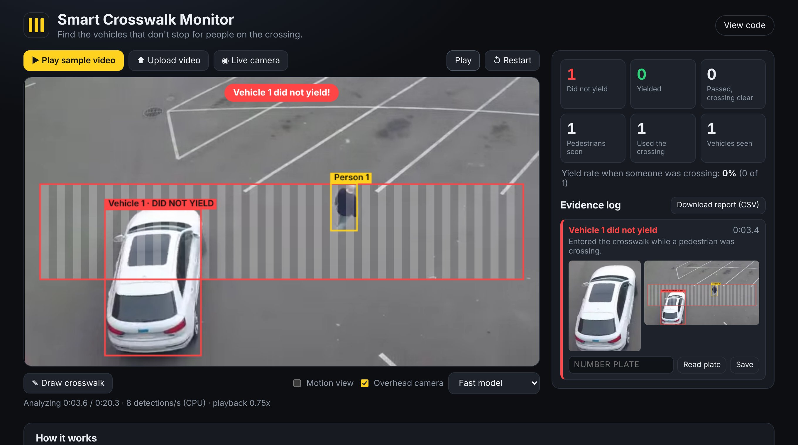

# Smart Crosswalk Monitor

**Live demo:** https://knarf24.github.io/smart-crosswalk-monitor/

Upload traffic footage, mark the crosswalk, and get a report of every vehicle that did not stop for a pedestrian, with a snapshot and a zoomed crop of each one. It runs entirely in the browser: no install, no server, and no video leaves your device.



## The problem
Pedestrians are hit at busy crossings, and nobody has data on how often drivers fail to stop. Councils, schools and residents' groups can use a phone video or an existing camera clip to measure it and back up a request for a speed bump, a signal or a crossing guard.

## Features
- **Pedestrian and vehicle detection** in every frame (MediaPipe Object Detector, EfficientDet COCO models, GPU with CPU fallback).
- **Tracking** so each person and vehicle is counted once.
- **Draw your own crosswalk** on any video by clicking its corners.
- **Background subtraction** (running average) to tell moving vehicles from parked ones, with a "Motion view" overlay.
- **Rules:** a moving vehicle that enters the crosswalk while a pedestrian is already on it **did not yield**; one that waits near the crossing first **yielded**; one that crosses when it is empty **passed clear**.
- **Evidence log** with the frame and a vehicle close-up for each event, plus **number plate reading** (Tesseract OCR) you can correct by hand.
- **Yield rate**, pedestrian and vehicle counts, and a **CSV report** download.
- Works with uploaded videos, a **live camera**, and a built-in sample clip. "Overhead camera" mode handles drone footage, where the detector often mislabels cars seen from above.

## Built from five GeeksforGeeks Python projects
| GeeksforGeeks project | Used here as |
|---|---|
| [Pedestrian Detection](https://www.geeksforgeeks.org/python/pedestrian-detection-using-opencv-python/) | Finding people in each frame |
| [Vehicle Detection in a Video frame](https://www.geeksforgeeks.org/python/opencv-python-program-vehicle-detection-video-frame/) | Finding cars, buses, trucks and motorbikes |
| [Detect and Recognize Car License Plate](https://www.geeksforgeeks.org/python/detect-and-recognize-car-license-plate-from-a-video-in-real-time/) | "Read plate" OCR on the vehicle close-up |
| [Background subtraction](https://www.geeksforgeeks.org/python/background-subtraction-opencv/) | Telling moving vehicles from parked ones |
| [Extract Frames](https://www.geeksforgeeks.org/python/python-program-extract-frames-using-opencv/) | Saving evidence snapshots |

The originals are desktop Python with OpenCV. This version is rewritten in JavaScript so anyone can try it from a link.

## Tips for your own footage
- A fixed camera works best. Draw the crosswalk to cover the painted stripes.
- Plates are only readable when the car is close and the video is sharp; you can always type the plate in.
- "Accurate model" finds more objects but is slower on phones.

## Run locally
```
python3 -m http.server 8000
```
Then open http://localhost:8000. Add `?cpu` to the URL to force CPU detection.

## Files
- `index.html`, `styles.css`, `app.js`: the app.
- `vendor/mediapipe/`: MediaPipe Tasks Vision 0.10.21 (Apache-2.0).
- `models/`: EfficientDet-Lite0 and Lite2 object detectors from MediaPipe (Apache-2.0).
- `vendor/tesseract/`: Tesseract.js 7 with the English LSTM model (Apache-2.0).
- `media/`: sample clip, see [media/ATTRIBUTION.md](media/ATTRIBUTION.md) (CC BY 4.0, Intel).

## Disclaimer
A demonstration and data-gathering tool. Detections can be wrong; do not use its output on its own to accuse or fine anyone.
